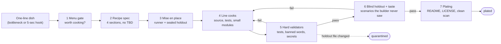

# Foundry

*Code owns the kitchen. Agents are the line cooks.*

Foundry is a deterministic **AI Developer Workflow (ADW)** runner. You hand it one line, the problem you attack or the five-second hook a user should feel, and it walks the work through seven stations. A station's gate is plain code: a dish moves forward only when every check passes, and every decision is written to a SQLite ledger. Agents propose files; they never decide that something is done.

Zero dependencies. Python 3.9+ standard library only (`sqlite3`, `json`, `hashlib`, `subprocess`, `pathlib`, `argparse`).



## Try it

```bash
python foundry.py --demo          # synthetic end-to-end run in a temp folder, exits 0
python -m unittest -v             # 78 tests (pytest works too)
```

The demo shows station 5 catching a planted flaw, the dish looping back to station 4, passing the blind holdout at station 6, and plating at station 7. A second dish shows a holdout edit being caught by its SHA-256 and the dish quarantined.

## Commands

```bash
python foundry.py init <dish-slug> --hook "<5-second magic or bottleneck>" --root <dir>
python foundry.py advance <dish-slug> --root <dir>      # run the current station's gate once
python foundry.py status [<dish-slug>] --root <dir> [--json]
python foundry.py --demo
```

`advance` exits 0 when the gate passed, 2 when it failed, 1 on a refusal.

## Layout

```
<root>/foundry.db            ledger: dishes, station_runs, gate_results, artifacts
<root>/banned_words.txt      one word per line; defaults written on first init
<root>/dishes/<slug>/        the sandbox the builder works in
<root>/holdouts/<slug>/      blind scenarios, outside the sandbox
```

## The seven stations

| # | Station | Gate (all must pass) |
|---|---|---|
| 1 | `1_menu_gate` | the hook has substance and is not a generic chatbot wrapper |
| 2 | `2_recipe_spec` | `SPEC.md` has User Journey, Performance Floor, Anti-Slop Rules, Privacy Boundaries, each filled in (no `TBD`) |
| 3 | `3_mise_en_place` | a runner file exists, the holdout folder is outside the sandbox, scenarios are sealed with SHA-256 |
| 4 | `4_line_cooks` | source and tests exist (`.py`, `.js`, `.mjs`, `.ts`), every module is 250 lines or fewer, holdout hashes unchanged |
| 5 | `5_hard_validators` | tests pass, no banned words (whole words, any case, UTF-8 or UTF-16), no secret shapes or local user paths, builder never referenced the holdout path, holdout hashes unchanged. Failure loops back to 4 |
| 6 | `6_blind_holdout_taste` | every sealed scenario passes, `taste_review.json` says `"verdict": "pass"`, holdout hashes unchanged. Failure loops back to 4 |
| 7 | `7_plating` | README and LICENSE present, validators clean again, blind scenarios and taste review re-run on the final code |

## Fail closed

- **Order is enforced from the ledger.** `advance` refuses unless the latest run of every earlier station passed, so editing the dish row to skip ahead does nothing.
- **The holdout is sealed.** Scenario files (`scenario_*.json`) are hashed when sealed. Any modified, added or deleted file at stations 4 to 7 fails the gate and quarantines the dish for good. Restoring the bytes afterward does not reopen it.
- **No tests is a failure.** A test command that reports zero tests fails station 5, on every Python version.
- **A tampered scenario is never run**, and a malformed one fails its gate instead of crashing the runner.
- **Everything is logged.** Each run and each gate result, with its detail line, is a row in `foundry.db`.

## Holdout scenarios

```json
{"name": "blind_two_plus_three", "cmd": ["{python}", "adder.py", "2", "3"],
 "expect_rc": 0, "expect_stdout_contains": "5"}
```

`{python}` becomes the running interpreter; commands run in the dish's sandbox.

## JavaScript and TypeScript dishes

Station 4 counts `.py`, `.js`, `.mjs` and `.ts` files as source. Test files are `test_*.py` / `test_*.js` or the
JavaScript conventions `*.test.mjs` and `*.spec.ts`. `node_modules`, `.venv`, `dist`, `build` and `*.min.js` are
still scanned for banned words and keys at station 5 but are never judged as the dish's own code, so a vendored
library cannot break the 250-line rule. Give a Node dish its own test command:

```bash
python foundry.py init js-adder --hook "Adds two numbers from one command" --test-cmd '["node", "--test"]'
```

## Banned words

`banned_words.txt` holds one word or phrase per line. A match must stand alone: no letter, digit or underscore
directly before or after it, so a banned word inside a longer English word (`cat` inside `concatenate`) never trips station 5,
while the word itself is caught in any case and beside any punctuation (`Word!`, `(word)`, `word-tier`). Files are
read as UTF-8, or as UTF-16 when they carry a byte-order mark or are mostly NUL bytes, so a word saved by a
UTF-16 editor is still found. Write scenarios before station 3 seals them. The taste review is a separate file the evaluator writes after looking at the running product.

## Honest limits

Foundry detects tampering; it does not stop a process that can read the holdout folder from reading it. Keep that folder where the builder agent's tools cannot reach; the hash check and the path check catch what slips through.

- **The builder writes the unit tests**, so station 5 trusts them only as far as the blind scenarios (stations 6 and 7) back them. A builder that shadows the test runner can fake a pass at 5, not at 6.
- **`taste_review.json` is not sealed.** It is a judgment an evaluator records after the scenarios run, so it must be written from outside the builder's reach.
- **The authoring window ends at station 3.** Scenarios can change until then; after sealing, any change quarantines the dish. A `foundry.db` that can be edited by hand is outside the threat model, though skipping a station or moving a dish backward past one that ran is refused.
- **Builder commands run with a trimmed environment** (no inherited keys). On Windows a timed-out command's child processes may outlive it.
- The "no tests ran" check reads the test runner's own message (`Ran 0 tests`, `NO TESTS RAN`); a custom test command should print one of those when it finds nothing.
- Keep dependencies out of the sandbox: every file except `.git` and caches is scanned, including `node_modules` and `.venv`.

## License

MIT
